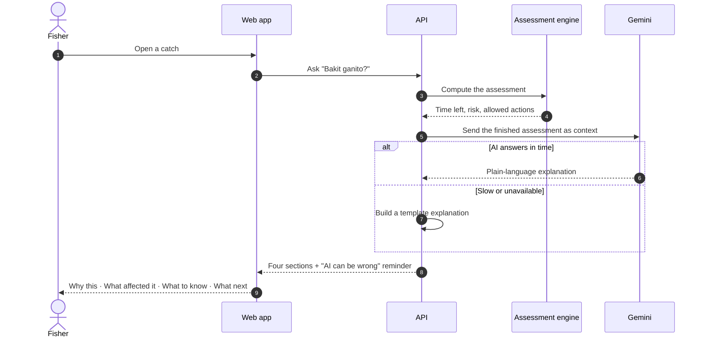

<p>
  <a href="https://lambat-app.onrender.com"></a>
  <a href="https://lambat-api.onrender.com"></a>
  
  
</p>

> **LAMBAT** is an AI-assisted web platform for post-catch loss prevention and value recovery, built for Filipino fisherfolk and coastal communities.

**Charted below:** [Dispatch](#dispatch) · [Soundings](#soundings) · [The Catch Cycle](#the-catch-cycle) · [On Deck](#on-deck) · [Gallery](#gallery) · [Under the Hull](#under-the-hull) · [Chart & Compass](#chart--compass) · [Safe Waters](#safe-waters) · [Launching](#launching) · [Voyage Plan](#voyage-plan) · [Crew Manifest](#crew-manifest)

---

## Dispatch

The boat is in. The ice is melting. Some of the catch is sold, some is not, and every hour changes what the unsold part is worth.

Most tools stop at *"here is a number."* LAMBAT keeps going. A fisher logs a catch, sees how much **marketable time** it may have left and how urgent the **risk** is, then picks a way forward while the fish still has value. Every result comes with a plain-language reason.

**Four design bets**

1. **Ice, not thermometers.** Most fisherfolk in our target community don't carry one. LAMBAT asks how many sacks or blocks of ice are on the catch.
2. **Pathways, not predictions.** A shelf-life number is only useful if it leads to an action: sell, find a buyer, redistribute, or a potential value-added pathway.
3. **Explained, not mysterious.** A grounded LLM explains each result in four short sections. It can never change the numbers.
4. **Honest by design.** LAMBAT is decision support, not food-safety certification, and it says so on every AI answer.

---

## Soundings

*What the problem looks like in numbers.*


A multi-hundred-billion-peso industry, carried by some of the poorest workers in the country. After landing, they must decide **what to act on first**, **who will buy**, and **what to do with what stays unsold**, usually without data or time.

<sub>Sources: [PSA, 2024 provincial production value](https://psa.gov.ph/content/provincial-value-production-agriculture-and-fisheries-2024) · [PSA fisherfolk poverty incidence, 2023, via BusinessWorld](https://www.bworldonline.com/?p=663031) · [Tadifa et al., 2022](https://www.nfrdi.da.gov.ph/tpjf/vol29_2/A%20Study%20on%20Postharvest%20Losses%20in%20Fisheries%20Owing%20to%20Changes%20in%20Market%20Supply%20and%20Demand%20in%20the%20Philippines.pdf). The 3.98% figure applies to the selected landing sites in that study.</sub>

---

## The Catch Cycle

Every catch in LAMBAT is a **buoy**. As its marketable time is used, the buoy sinks, and the app surfaces the ones that need you first.


When a catch is assessed, the **Fork in the Net** opens:


---

## On Deck

What each role can do.

<table>
<tr>
<th width="34%">🎣 Fisherfolk</th>
<th width="33%">🛒 Buyers</th>
<th width="33%">🛡️ Admins</th>
</tr>
<tr>
<td valign="top">

- **Itala ang Huli:** guided catch logging with an ice stepper
- **Shelf-life and risk** for 10 local species
- **Fork in the Net** pathways
- **Bakit ganito?** grounded AI explanation
- **Value-added guides:** daing, tuyo, tinapa, paksiw, bagoong isda, based on DOST-ITDI material
- **Panahon:** weather and sea conditions
- **Alerts** for high-risk catches

</td>
<td valign="top">

- Apply for an account
- Wait for **admin approval**
- Browse available catches
- Check species and quantity
- Submit offers

</td>
<td valign="top">

- Review and decide on buyer applications
- Moderate accounts
- Publish community advisories
- Admin data is driven by real fisherfolk and buyer activity

</td>
</tr>
</table>

Language support covers **English and Filipino**. Touch targets are sized for use on the pier, and the identity follows the sea: buoys, a net-lattice navigation, lifebuoy timers and a net-shaped weekly tally.

---

## Gallery

<table>
<tr>
<td width="25%"></td>
<td width="25%"></td>
<td width="25%"></td>
<td width="25%"></td>
</tr>
<tr>
<td align="center"><sub>Home</sub></td>
<td align="center"><sub>Log a catch</sub></td>
<td align="center"><sub>Catch details</sub></td>
<td align="center"><sub>Fork in the Net</sub></td>
</tr>
</table>

<details>
<summary><b>More screens: weather, value-added, buyer, admin, desktop</b></summary>

<br>

<table>
<tr>
<td width="50%"></td>
<td width="50%"></td>
</tr>
<tr>
<td width="50%"></td>
<td width="50%"></td>
</tr>
</table>


</details>

---

## Under the Hull

| Layer | Choice | Why |
|---|---|---|
| Frontend | React, Vite, TypeScript, Tailwind | Fast, responsive, mobile-first |
| Backend | Node, Express, TypeScript | One language across the stack |
| Data | Prisma on Supabase Postgres | Versioned migrations and typed queries |
| AI | Gemini LLM | Explains results, grounded in backend data |
| Weather | Open-Meteo | Free forecasts for temperature, wind and waves |
| SMS | Semaphore | Low-connectivity alerts, currently in dry-run |
| Hosting | Render | Live API and web app |

---

## Chart & Compass

How a **"Bakit ganito?"** answer is made. The backend decides, and the AI only explains.



The API ships with a one-command regression suite covering authentication, account security, catches and the assessment engine, pathways, advisories, the marketplace, weather and admin moderation:

```powershell
cd backend
npm run test:api
```

---

## Safe Waters

> [!IMPORTANT]
> LAMBAT is **decision support, not food-safety certification.** Marketable time is an **estimate** based on what the user records, and the fisher always makes the final call.

- Value-added results are always worded as a **"potential value-added pathway."** LAMBAT never implies that an unsafe catch can be made safe by processing.
- AI explanations are grounded in the backend result and labeled **"AI can be wrong."**
- Buyer accounts stay **pending until an admin approves them**, and admin accounts are created only by an admin.

---

## Launching

**You'll need:** Node.js 18+, a Postgres database (Supabase works) and Git.

```powershell
# 1. Get the code
git clone https://github.com/<your-username>/lambat.git
cd lambat

# 2. Backend
cd backend
npm install
copy .env.example .env
npx prisma migrate dev
npm run dev
```

```powershell
# 3. Frontend (new terminal, from the lambat folder)
cd frontend
npm install
npm run dev
```

> Adjust script names if your `package.json` differs.

| Variable | Purpose |
|---|---|
| `DATABASE_URL` | Postgres connection string |
| `JWT_SECRET` | Secret for signing login tokens |
| `GEMINI_API_KEY` | Enables "Bakit ganito?" explanations |
| `SMS_DRY_RUN` | Keep `true` to log SMS instead of sending |

---

## Voyage Plan

**⚓ Anchored (done)**
- [x] Fisherfolk app: logging, assessment, pathways, weather, buyers
- [x] Authentication with role-based access
- [x] Backend API with automated tests
- [x] Production deployment on Render and Supabase
- [x] Grounded "Bakit ganito?" explanations

**⛵ Under way**
- [ ] Scheduled high-risk alerts
- [ ] Cached explanations for faster answers
- [ ] Live SMS through Semaphore

**🔭 On the horizon**
- [ ] Verified field inputs: ice-to-temperature mapping and kilos per sack
- [ ] Field pilot with fisherfolk in Balayan

**How we'd measure success in a pilot:** time from alert to action · share of listings that receive offers · kilos recovered through sale, processing or redistribution · kilos discarded per trip.

---

## Crew Manifest

| Station | Name | Focus |
|---|---|---|
| Helm | [Name] | [e.g. product, frontend] |
| Engine room | [Name] | [e.g. backend, database] |
| Navigator | [Name] | [e.g. research, AI, testing] |

*Third-year Computer Science students, Batangas State University.*

**Fair winds to** [Adviser name], for the guidance that shaped LAMBAT, including the advice to ground an LLM instead of training a model without data, and to the fisherfolk and coastal communities who inspired it.

<br>

<p align="center"><sub>Made with care for the people who feed the nation. 🇵🇭</sub></p>
