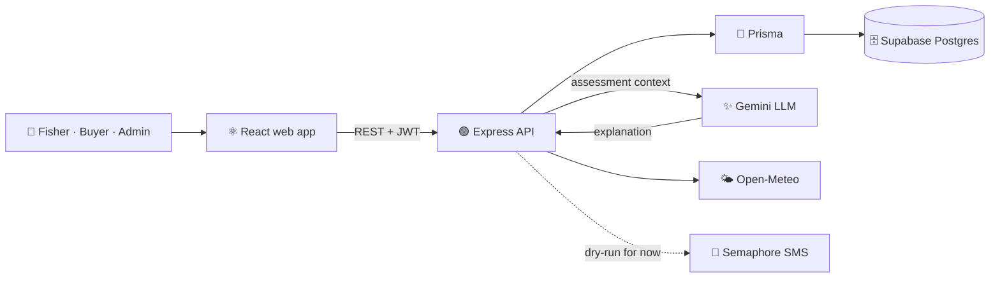

<div align="center">


<br>


<br>

*— the system that tells a fisher what the catch can still become —*

<br>

<p>
  <a href="https://lambat-app.onrender.com"></a>
  <a href="https://lambat-api.onrender.com"></a>
  
  
</p>

<p>
  
  
  
  
  
  
  
</p>

<br>

<kbd>🎣 Catch Logging</kbd>&nbsp;
<kbd>⏱️ Shelf-Life Estimate</kbd>&nbsp;
<kbd>🪢 Action Pathways</kbd>&nbsp;
<kbd>💡 Grounded AI</kbd>&nbsp;
<kbd>🤝 Buyer Matching</kbd>&nbsp;
<kbd>🌤️ Weather</kbd>

</div>

<br>

<div align="center">

## 🌊 𝐏𝐑𝐎𝐉𝐄𝐂𝐓 𝐃𝐄𝐒𝐂𝐑𝐈𝐏𝐓𝐈𝐎𝐍

</div>

**LAMBAT** is an **AI-Assisted Post-Catch Loss Prevention and Value Recovery Platform for Filipino Fisherfolk and Coastal Communities.**

When a boat lands, the clock is already running. A fisher has to decide which batch to act on first, who will buy it, and what to do with whatever stays unsold, usually with no thermometer, no data, and no time.

LAMBAT turns those minutes into a clear decision. The fisher records a catch, sees **how much marketable time it may have left** and **how urgent the risk is**, then chooses a pathway while the fish still has value.

<br>

<div align="center">

## 📉 𝐓𝐇𝐄 𝐏𝐑𝐎𝐁𝐋𝐄𝐌

> *— a multi-billion-peso industry, and the people behind it are still among the poorest —*

</div>


<sub>Sources: [PSA, 2024 provincial production value](https://psa.gov.ph/content/provincial-value-production-agriculture-and-fisheries-2024) · [PSA fisherfolk poverty incidence, 2023 (via BusinessWorld)](https://www.bworldonline.com/?p=663031) · [Tadifa et al., 2022](https://www.nfrdi.da.gov.ph/tpjf/vol29_2/A%20Study%20on%20Postharvest%20Losses%20in%20Fisheries%20Owing%20to%20Changes%20in%20Market%20Supply%20and%20Demand%20in%20the%20Philippines.pdf). The 3.98% figure refers to the selected landing sites in that study.</sub>

After landing, four things go missing:

| Gap | What fisherfolk face |
|---|---|
| ⏱️ **Time** | No simple way to know which batch needs action first |
| 🤝 **Access** | No easy link to buyers while the fish still has value |
| 🐟 **Options** | No guidance on what to do with unsold catch |
| 💡 **Trust** | No explanation behind any advice |

<br>

<div align="center">

## 🎯 𝐏𝐔𝐑𝐏𝐎𝐒𝐄

</div>

LAMBAT exists to help fisherfolk act **earlier, smarter, and with understanding**. Through the platform, a user can:

- ⏱️ **See** how much marketable time a batch may have left
- 🧭 **Choose** between selling, finding a buyer, redistributing, or a potential value-added pathway
- 💡 **Understand** why the system suggests an action
- 🌤️ **Plan** around weather and sea conditions

<br>

<div align="center">

## 🗂️ 𝐅𝐄𝐀𝐓𝐔𝐑𝐄𝐒 & 𝐅𝐔𝐍𝐂𝐓𝐈𝐎𝐍𝐀𝐋𝐈𝐓𝐈𝐄𝐒

</div>

### 🎣 Fisherfolk

| Feature | Functionality |
|---|---|
| 🎣 **Itala ang Huli** | A guided flow to record species, catch time, quantity and ice |
| ⏱️ **Shelf-Life & Spoilage Risk** | Estimated marketable time and risk level for 10 local species, based on a literature-backed species table |
| 🪢 **Fork in the Net** | Four pathways per catch: sell, find a buyer, redistribute, or a potential value-added pathway |
| 💡 **Bakit ganito?** | A grounded AI explanation of the result, with a fixed "AI can be wrong" reminder and a safe template fallback |
| 🐟 **Pagpapalaki ng Halaga** | Daing, tuyo, tinapa, paksiw and bagoong isda, each with required and avoid conditions and a process guide based on DOST-ITDI material |
| 🌤️ **Panahon** | Temperature, wind and wave conditions powered by Open-Meteo |
| 🔔 **Alerts** | High-risk catch alerts and community advisories |

### 🛒 Buyers

| Feature | Functionality |
|---|---|
| 📝 **Registration & Approval** | Buyers apply, then wait for admin approval before they can transact |
| 🔎 **Browse Listings** | View available catches with species and quantity |
| 💬 **Offers** | Submit offers on listed catches |

### 🛡️ Admins

| Feature | Functionality |
|---|---|
| ✅ **Buyer Verification** | Review applications and record decisions |
| 🚦 **Account Moderation** | Manage accounts, driven by real fisherfolk and buyer data |
| 📣 **Advisories** | Publish community notices |

### 🌐 Experience

English and Filipino support, a sea-inspired identity (buoys that sink as freshness is used, a net-lattice navigation, lifebuoy timers, a net-shaped weekly tally), and large touch targets for use on the pier.

<br>

<div align="center">

## ✦ ⋆ ˚｡ 𝐓𝐇𝐄 𝐒𝐓𝐀𝐂𝐊 𝐁𝐄𝐇𝐈𝐍𝐃 𝐈𝐓 ˚｡ ⋆ ✦

</div>

<table align="center">
<tr>

<td align="center" width="20%">
<h3>⚛️</h3>
<b>React + Vite</b>
<br><sub>TypeScript and Tailwind CSS<br>for a fast, responsive UI</sub>
</td>

<td align="center" width="20%">
<h3>🟢</h3>
<b>Node + Express</b>
<br><sub>TypeScript REST API with<br>role-based access control</sub>
</td>

<td align="center" width="20%">
<h3>🔷</h3>
<b>Prisma + Postgres</b>
<br><sub>Supabase-hosted database with<br>versioned migrations</sub>
</td>

<td align="center" width="20%">
<h3>✨</h3>
<b>Gemini LLM</b>
<br><sub>Grounded explanations with<br>a template fallback</sub>
</td>

<td align="center" width="20%">
<h3>☁️</h3>
<b>Render</b>
<br><sub>Live deployment of the<br>API and the web app</sub>
</td>

</tr>
</table>

<div align="center">
<sub>Also: Open-Meteo for weather · Semaphore for SMS (dry-run for now)</sub>
</div>

<br>

<div align="center">

## 🖥️ 𝐒𝐘𝐒𝐓𝐄𝐌 𝐏𝐑𝐄𝐕𝐈𝐄𝐖

> — *the system in action* —

</div>

<table width="100%">
<tr>
<td align="center">

### 🏠 HOME


*Active buoys, swipeable catches and the weekly tally*

</td>
</tr>
</table>

<br>

<table width="100%">
<tr>
<td align="center" width="50%">

### 🎣 ITALA ANG HULI


*Guided catch logging with the ice stepper*

</td>
<td align="center" width="50%">

### ⏱️ CATCH DETAILS


*Marketable time, risk and Bakit ganito?*

</td>
</tr>
<tr>
<td align="center" width="50%">

### 🪢 FORK IN THE NET


*Sell, find a buyer, redistribute or add value*

</td>
<td align="center" width="50%">

### 🐟 VALUE-ADDED


*Pathway cards with process guides*

</td>
</tr>
<tr>
<td align="center" width="50%">

### 🌤️ PANAHON


*Weather and sea conditions*

</td>
<td align="center" width="50%">

### 🛒 BUYER WORKSPACE


*Listings and offers*

</td>
</tr>
<tr>
<td align="center" colspan="2">

### 🛡️ ADMIN CONSOLE


*Buyer verification and advisories*

</td>
</tr>
</table>

<br>

<div align="center">

## ⚙️ 𝐇𝐎𝐖 𝐈𝐓 𝐖𝐎𝐑𝐊𝐒

</div>


<br>

<div align="center">

## 🏗️ 𝐀𝐑𝐂𝐇𝐈𝐓𝐄𝐂𝐓𝐔𝐑𝐄

</div>



<br>

<div align="center">

## 🧠 𝐃𝐄𝐒𝐈𝐆𝐍 𝐃𝐄𝐂𝐈𝐒𝐈𝐎𝐍𝐒

</div>

<table>
<tr>
<td width="100%" align="center">


</td>
</tr>
<tr>
<td>

Every number the user sees, such as marketable time, risk level and allowed actions, is computed by the backend. The LLM never produces or changes them. It receives the finished assessment and may only **explain** it.

<details>
<summary><b>📄 What the AI receives (simplified)</b></summary>

<br>

```json
{
  "catch": { "species": "...", "catchTime": "...", "kilos": 0, "ice": "..." },
  "assessment": { "remainingHours": 0, "riskLevel": "...", "factors": ["..."] },
  "allowedNextActions": ["sell", "find_buyer", "redistribute", "value_added"]
}
```

</details>

</td>
</tr>
</table>

<br>

<table>
<tr>
<td width="100%" align="center">


</td>
</tr>
<tr>
<td>

Most fisherfolk in our target community do not carry a thermometer. LAMBAT asks for the thing they already know: **how many sacks or blocks of ice** are on the catch, with an optional kilos override.

</td>
</tr>
</table>

<br>

<table>
<tr>
<td width="100%" align="center">


</td>
</tr>
<tr>
<td>

If the AI is slow or unavailable, the system falls back to a **template explanation** built from the same backend result, so the fisher always gets a clear answer. Every AI explanation ends with a reminder that **AI can be wrong**.

</td>
</tr>
</table>

<br>

<table>
<tr>
<td width="100%" align="center">


</td>
</tr>
<tr>
<td>

The API ships with a one-command regression suite covering authentication, account security, catches and the assessment engine, pathways, advisories, the marketplace, weather and admin moderation.

```powershell
cd backend
npm run test:api
```

</td>
</tr>
</table>

<br>

<div align="center">

## 🛡️ 𝐑𝐄𝐒𝐏𝐎𝐍𝐒𝐈𝐁𝐋𝐄 𝐔𝐒𝐄

</div>

> [!IMPORTANT]
> LAMBAT is **decision support, not food-safety certification.** The marketable time is an **estimate** based on the details the user records. The fisher always makes the final handling and selling decision.

- 🐟 Value-added results are always worded as a **"potential value-added pathway."** LAMBAT never implies that an unsafe catch can be made safe by processing.
- 💡 AI explanations are grounded in the backend result and labeled **"AI can be wrong."**
- 🔐 Buyer accounts stay **pending until an admin approves them**, and admin accounts are created only by an admin.

<br>

<div align="center">

## 🚀 𝐆𝐄𝐓𝐓𝐈𝐍𝐆 𝐒𝐓𝐀𝐑𝐓𝐄𝐃

</div>

<div align="left">

### Prerequisites

- Node.js 18 or higher
- A Postgres database (Supabase works)
- Git

### Installation & Running

**1. Clone the repository**

```powershell
git clone https://github.com/<your-username>/lambat.git
cd lambat
```

**2. Start the backend**

```powershell
cd backend
npm install
copy .env.example .env
npx prisma migrate dev
npm run dev
```

**3. Start the frontend** *(in a new terminal)*

```powershell
cd frontend
npm install
npm run dev
```

> Adjust script names if your `package.json` differs.

### Environment variables

See `backend/.env.example`.

| Variable | Purpose |
|---|---|
| `DATABASE_URL` | Postgres connection string |
| `JWT_SECRET` | Secret for signing login tokens |
| `GEMINI_API_KEY` | Enables "Bakit ganito?" explanations |
| `SMS_DRY_RUN` | Keep `true` to log SMS instead of sending |

</div>

<br>

<div align="center">

## 🗺️ 𝐑𝐎𝐀𝐃𝐌𝐀𝐏

</div>

| Status | Milestone |
|---|---|
| ✅ Done | Fisherfolk app: logging, assessment, pathways, weather, buyers |
| ✅ Done | Authentication with role-based access (fisherfolk, buyer, admin) |
| ✅ Done | Backend API with automated tests |
| ✅ Done | Production deployment on Render and Supabase |
| ✅ Done | Grounded "Bakit ganito?" explanations |
| 🚧 Next | Scheduled high-risk alerts and cached explanations |
| 🚧 Next | Live SMS alerts through Semaphore |
| 🧪 Planned | Verified field inputs: ice-to-temperature mapping and kilos per sack |
| 🧪 Planned | Field pilot with fisherfolk in Balayan |

**Proposed pilot measures:** time from alert to action · share of listings that receive offers · kilos recovered through sale, processing or redistribution · kilos discarded per trip.

<br>

<div align="center">

## 𝐌𝐄𝐄𝐓 𝐓𝐇𝐄 𝐓𝐄𝐀𝐌

<table>
<tr>

<td align="center" width="33%">


━━━━━━━━━━━


<b>[SURNAME, FIRST NAME]</b>

<i>[Role]</i>

</td>

<td align="center" width="33%">


━━━━━━━━━━━


<b>[SURNAME, FIRST NAME]</b>

<i>[Role]</i>

</td>

<td align="center" width="33%">


━━━━━━━━━━━


<b>[SURNAME, FIRST NAME]</b>

<i>[Role]</i>

</td>

</tr>
</table>

<sub>Third-year Computer Science students · Batangas State University</sub>

<br>

### 🫶🏻 𝐀𝐂𝐊𝐍𝐎𝐖𝐋𝐄𝐃𝐆𝐄𝐌𝐄𝐍𝐓

</div>

<div align="left">

We would like to thank **[Adviser / Professor name]** for the guidance, feedback and encouragement that shaped LAMBAT, including the advice to ground an LLM instead of training a model without data.

We also thank the fisherfolk and coastal communities whose daily reality inspired this project, and every member of the **LAMBAT team** for the late nights, the failed builds, and the 503 errors that taught us to build a fallback.

</div>

<br><br>

<div align="center">


<br>


<br>

**LAMBAT helps fisherfolk see which catch needs attention, understand why, and choose what to do while it still has value.**

*© 2026 LAMBAT. Made with care for the people who feed the nation.* 🇵🇭

</div>
